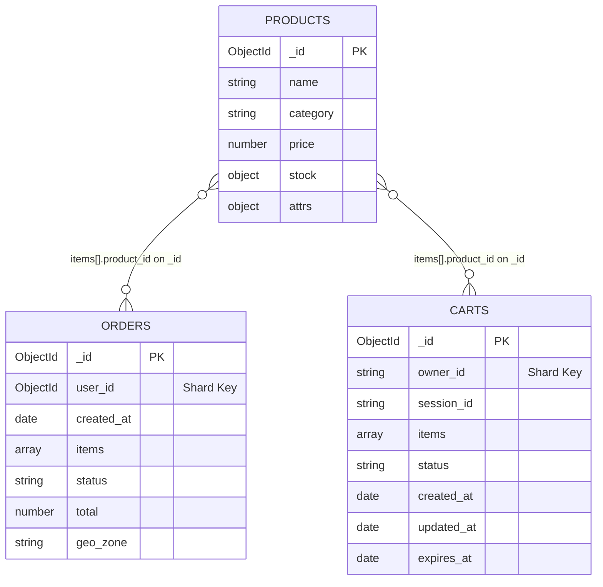

# Задание 7. Проектирование схем коллекций и шардирования

## Описание подхода
Связи между коллекциями реализованы через **reference** (`product_id` → `products._id`), вложенные массивы (`items`) используются для денормализации в заказах и корзинах, алгоритм шардирования выбран под основные паттерны чтения/записи.


## Схемы коллекций
### 1. Заказы [orders]
Хэшированное шардирование по user_id для того, чтобы все заказы пользователя лежали на одном шарде для ускорения получения списка заказов.

| Поле         | Тип      | Описание                                                                            |
| ------------ | -------- |-------------------------------------------------------------------------------------|
| `_id`        | ObjectId | PK заказа                                                                           |
| `user_id`    | ObjectId | **Шард-ключ**. Ссылка на пользователя                                               |
| `created_at` | ISODate  | Дата оформления                                                                     |
| `items`      | Array    | `[{ product_id: ObjectId, qty: Number, price: Number }]`, тут цена на момент заказа |
| `status`     | String   | `created`, `paid`, `shipped`, `delivered`, `cancelled`                              |
| `total`      | Number   | Итоговая сумма                                                                      |
| `geo_zone`   | String   | Геозона доставки                                                                    |

### 2. Товары [products]
Хэшированное шардирование для равномерного распределения по шардам.

| Поле       | Тип      | Описание                                                    |
|------------|----------|-------------------------------------------------------------|
| `_id`      | ObjectId | PK товара                                                   |
| `name`     | String   | Наименование                                                |
| `category` | String   | Категория (электроника, книги и т.д.)                       |
| `price`    | Number   | Базовая цена                                                |
| `stock`    | Object   | Остатки по геозонам: `{ "Москва": 50, "Екатеринбург": 30 }` |
| `attrs`    | Object   | Доп. атрибуты: `{ color: "black", size: "128GB" }`          |

### 3. Корзины [carts]
Шардирование по искусственному ключу, представляющему собой либо user_id, либо session_id для неавторизованных пользователей. Необходимо для того, чтобы все корзины пользователя были на одном шарде, но при этом чтобы избежать скопления корзин неавторизованных пользователей на одном конкретном шарде.

| Поле         | Тип      | Описание                                                           |
| ------------ | -------- | ------------------------------------------------------------------ |
| `_id`        | ObjectId | PK корзины                                                         |
| `owner_id`   | String   | **Шард-ключ**. `user_id` (авторизованный) или `session_id` (гость) |
| `session_id` | String   | ID сессии (для гостей)                                             |
| `items`      | Array    | `[{ product_id: ObjectId, qty: Number }]`                          |
| `status`     | String   | `active` \| `ordered` \| `abandoned`                               |
| `created_at` | ISODate  | Создание                                                           |
| `updated_at` | ISODate  | Последнее обновление                                               |
| `expires_at` | ISODate  | TTL для автоочистки                                                |


## Связи



## Запросы
### 1. Заказы [orders]

Инициализация
```js
sh.shardCollection("shop.orders", { user_id: "hashed" })
```

Получение списка заказов пользователя
```js
db.orders.find({ user_id: ObjectId("USER_ID") }).sort({ created_at: -1 })
```

### 2. Товары [products]
Инициализация
```js
sh.shardCollection("shop.products", { _id: "hashed" })
```

Обновление остатков
```js
db.products.updateOne(
  { _id: ObjectId("66c2f..."), "stock.Москва": { $gte: 1 } },
  { $inc: { "stock.Москва": -1 } }
)
```

### 3. Корзины [carts]
Инициализация
```js
sh.shardCollection("shop.carts", { owner_id: "hashed" })
```
Получение активной корзины
```js
db.carts.findOne({ owner_id: "SESSION_ID_OR_USER_ID", status: "active" })
```

Слияние корзин
```js
const guestCart = db.carts.findOne({ owner_id: "GUEST_SESSION_ID", status: "active" })
db.carts.updateOne(
  { owner_id: "CURRENT_USER_ID", status: "active" },
  { $push: { items: { $each: guestCart.items } } }
)
db.carts.updateOne(
  { _id: guestCart._id },
  { $set: { status: "abandoned" } }
)
```